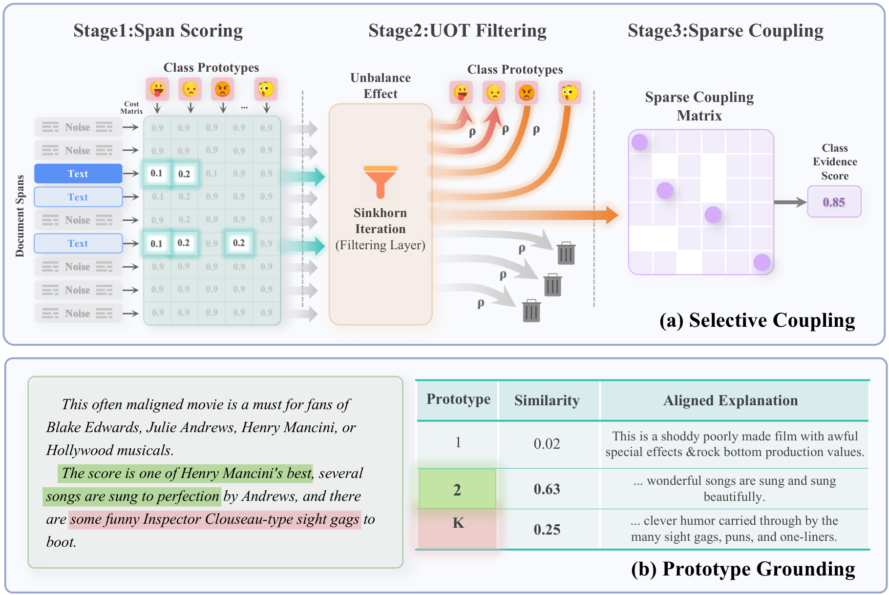

<div align="center">


[](https://aclanthology.org/2026.acl-long.290/)

</div>

This code is a **PyTorch** implementation of our paper "**SCOUT: Selective Coupling via Optimal Unbalanced Transport for Interpretable Text Classification**", accepted to **ACL 2026 Main (Oral; Award Candidate)**.

<div align="center">

<div style="display:flex;gap:10px;">
  
</div>

</div>

**Fig. 1.** Overview of the **SCOUT** framework. **Selective Coupling (top)** scores document spans, applies **Unbalanced Optimal Transport (UOT)** to filter irrelevant evidence, and constructs span-to-prototype couplings for classification. **Prototype Grounding (bottom)** connects the selected evidence to readable spans from training examples, providing case-based explanations of the prediction.

## 🧑🏻‍🏫 Background

**Interpretable text classification** seeks to explain a prediction through evidence that a reader can inspect. Prototype-based reasoning connects an input to representative training examples, but an entire document may contain both class-relevant evidence and distracting content. **SCOUT** represents documents and class prototypes as distributions of text spans so that classification and explanation can use the same matching process.

## 😖 Current Challenges

- **Irrelevant spans can obscure class evidence.** Matching a complete document to a prototype can give distracting content an unnecessary role in the decision.

- **Rigid matching can force unsuitable correspondences.** Different documents and prototypes contain different amounts of useful evidence, motivating a transport formulation that can relax marginal constraints.

- **Latent prototypes need readable grounding.** A useful explanation should identify the input spans, the responsible prototypes, and the training spans that support the decision.

## 🌟 Primary Contributions

We introduce **SCOUT**, a framework for selective coupling via optimal unbalanced transport. The implementation brings together the following components:

- **Span distributions** built from contextual token representations, contiguous word spans, and a learned span-scoring head.

- **Class-specific anchored prototypes** whose supports are initialized from training spans and projected back to readable training examples after each epoch.

- **Unbalanced entropic optimal transport** solved with log-domain generalized Sinkhorn iterations, allowing selective matching between document spans and prototype supports.

- **Joint prediction and explanation** through soft-min prototype aggregation, distance-based classification, transported evidence mass, and exported span-to-anchor links.

## ⚙️ Prerequisites

- Linux or Windows
- Python 3.11 or a compatible Python environment
- The packages listed in `requirements.txt`
- A CUDA-enabled NVIDIA GPU is recommended for training; the scripts fall back to CPU when CUDA is unavailable.
- Access to the selected Hugging Face encoder and dataset, or locally cached copies and local data

## 🧪 Implementation Details

The following settings are the **defaults of this code release**. They should not be interpreted as a complete description of every experiment in the paper.

The default encoder is **RoBERTa-base** with a maximum input length of **256 tokens**. The model enumerates contiguous spans of **1 to 5 words** and retains the **50 highest-scoring spans** per document. Each class has **5 prototypes**, each with **5 anchored supports**. Prototype supports are stored as buffers and updated by projection onto training spans. For recognized encoder architectures, the encoder is frozen except for its final transformer block; the span-scoring head remains trainable.

The UOT layer uses an entropic regularization coefficient of **0.05**, a marginal relaxation coefficient of **1.0**, and **20 Sinkhorn iterations**. The prototype soft-min parameter is **10.0**, and the distance-softmax scale is **1.0**. Training combines cross-entropy with clustering, separation, and evidence regularization terms, with default weights of **1.0**, **1.0**, and **0.1** for the latter three terms.

Training uses **AdamW**, a learning rate of **3e-5**, weight decay of **0.01**, batch size **8**, and **10 epochs**. The seed is **42**, gradient norm clipping is **1.0**, and the best checkpoint is selected by **validation macro-F1**. Evaluation reports accuracy and macro-F1.

This release keeps RoBERTa tokenization consistent across training and inference, runs explanation export in evaluation mode, aligns evidence with the selected explanation class, and saves the readable anchors together with the selected best checkpoint. The model formulation and default hyperparameters are unchanged.

## 📦 Datasets

The dataset loader supports Hugging Face datasets with text and integer label fields. The provided examples cover **IMDb** for binary sentiment classification and **DBpedia-14** for 14-class classification. Data and encoder weights are downloaded by the corresponding Hugging Face libraries when they are not already cached.

For a local dataset, provide `train.csv`, `test.csv`, and optionally `val.csv` in the same directory. TSV and JSONL files are also supported. Each file must contain **`text`** and **`label`** fields, with class labels numbered from `0` to `num_classes - 1`.

```json
{"text": "This movie was surprisingly good.", "label": 1}
```

If a validation split is absent, the final 10% of the available training examples is used for validation. For Hugging Face datasets without a test split, the loader first reserves the final 10% of the original training examples for testing. These fallback splits follow the input order.

## 🌵 Dependencies

```bash
pip install -r requirements.txt
```

<div align="center">

| Dependencies | Versions | Dependencies | Versions | Dependencies | Versions |
|--------------|----------|--------------|----------|--------------|----------|
| torch | >=2.1 | transformers | >=4.40 | datasets | >=2.18 |
| numpy | >=1.23 | tqdm | >=4.66 | scikit-learn | >=1.3 |
| nltk | >=3.8 | | | | |

</div>

These are the declared dependency constraints, rather than a locked environment. Install a PyTorch build appropriate for your hardware.

## 🍳 Training

Clone the repository and enter its directory:

```bash
git clone https://github.com/JonahJia/SCOUT.git
cd SCOUT
```

Train on IMDb:

```bash
python train.py --dataset imdb --encoder roberta-base --num_classes 2 --max_epochs 10
```

Train on DBpedia-14:

```bash
python train.py --dataset dbpedia_14 --encoder roberta-base --num_classes 14 --max_epochs 10
```

Train on local data:

```bash
python train.py --dataset local --data_dir data/my_dataset --encoder roberta-base --num_classes 2
```

The default output paths are `Models/best.pt` and `Models/anchors.json`. Use `python train.py --help` to see the available settings and output-path arguments.

## 🗃️ Checkpoints

**Pretrained SCOUT checkpoints are not included in this release.** Training creates `Models/best.pt`, containing the selected model state and its training arguments, and `Models/anchors.json`, containing the matching readable anchor metadata.

The supplied `Models/anchors.json` is an example with **50 anchor records for two classes**. It is metadata, not a trained model checkpoint. Run training to generate a matching checkpoint and anchor file, and keep that pair together when running inference.

## 🚅 Inference

Export predictions and case-based explanations from the test split:

```bash
python eval_and_explain.py \
  --ckpt_path Models/best.pt \
  --anchors_path Models/anchors.json \
  --dataset imdb \
  --export_json Outputs/cases.json \
  --export_html Outputs/cases.html \
  --num_cases 20
```

For local data, replace `--dataset imdb` with `--dataset local --data_dir data/my_dataset`. The encoder and class count are read from the checkpoint unless explicitly overridden.

Run inference on a single text:

```bash
python infer_one.py \
  --ckpt_path Models/best.pt \
  --anchors_path Models/anchors.json \
  --encoder roberta-base \
  --num_classes 2 \
  --text "This movie was surprisingly good." \
  --out_html Outputs/one.html
```

Use the same encoder, class count, and maximum length as the training run. The exported HTML contains highlighted evidence spans, prototype responsibilities, readable anchors, and span-to-support links.

## 📄 License

See [LICENSE](LICENSE) for the license information supplied with this release. The provided file contains an abbreviated MIT notice.
